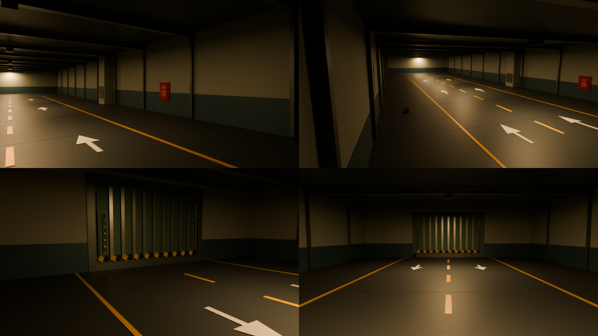

# Car-deck lighting reference — development experiment

This isolated study uses The Last Crossing's saved Marmorica car-deck scene. It is not imported by the application, and it has not been installed in the deployed Replit worker. Do not publish or merge the app as part of resuming this study.

## Verified output

- 236 scene objects; source scene hash matches `reference/lighting-report.json`.
- Four 640 × 360 camera views, CPU Cycles, 32 samples, seed 41, denoising.
- Rendered on the Mac with Blender 4.5.12 LTS: 123.077 seconds including setup; four image renders took 117.938 seconds. This is not a cloud benchmark.
- All cameras share AgX, Medium High Contrast, exposure 0, gamma 1. No per-camera exposure adjustments.
- Five car-deck emitters retain their saved centres: x=0, y=7/15/23/31/39, z=3.49 metres. Each is 300 W, diameter 0.28 m, RGB [1, 0.60, 0.28]. The previous 2.5 m emitter exceeded the visible fixture size. Upstairs lights are untouched.
- World strength 0.15; warm fixture emission strength 1.5. These are proposed design settings, not a surveyed ferry or measured photometric match.
- Geometry, camera positions and the saved film were not modified for this lighting study. The raised loading ramp remains closed.



The reference is deliberately dim and warm. Its approval is still a design decision; it is not a guarantee of finished image-model quality. The low-exposure trial was not selected.

## Reproduce (Mac or Linux development machine)

Run from the repository root. Use the official installed Blender executable; on Linux replace the Mac path below with `blender` or the approved absolute executable. Blender supplies its own Python and NumPy. The recorded run used 4.5.12 LTS on macOS; reproduction with the worker's pinned Linux 5.2.3 LTS remains untested for this new AgX treatment.

```sh
/Applications/Blender.app/Contents/MacOS/Blender --background --factory-startup --threads 4 --python experiments/car-deck-lighting/render_scene.py -- --scene experiments/car-deck-lighting/scene.json --out experiments/car-deck-lighting/output --width 640 --height 360 --samples 32 --final-lighting
```

This writes four PNGs, a combined grid, a report and an editable `lighting-reference.blend` under ignored `output/`. The report records source hash, camera data and actual duration. Do not replace the cloud worker's renderer with this experimental copy.

To reproduce object-boundary guides in an isolated Python environment (tested with Python 3.9):

```sh
python3 -m venv /tmp/kinolot-guide-venv
/tmp/kinolot-guide-venv/bin/python -m pip install -r experiments/car-deck-lighting/requirements-guides.txt
/tmp/kinolot-guide-venv/bin/python experiments/car-deck-lighting/prepare_guides.py
```

Depth and object-ID inputs are earlier cloud technical passes from this identical scene/camera. They were not rerendered in the new lighting run. Lighting does not change their geometry. The outline shows boundaries between object IDs, not all edges within each mesh. `comparison-inputs.json` records the scene and image checksums.

## Comparison results (31 October 2026)

The TL view was run once each through Kinolot's image path; settings, timings and findings are in `comparison-inputs.json` → `modelRuns`, and the images and sheets in ignored `output/model-comparison/`. The first two runs were sent the old outline, which was ~64% noise: the ID pass is dithered by ±1 and `prepare_guides.py` treated any difference as a boundary. It now uses a tolerance of 8 (10.9% boundary pixels, two pixels wide). **GPT Image 2.5 Sunburst kept the Blender structure and the warm mood best.** Nano Banana 2.1 with the clean outline no longer invented the far-end opening and placed the cabinet correctly, but still added ceiling pipes, brightened the walls and dashed the yellow lane line. Sunburst re-run with the clean outline came out almost the same as its first run, so the clean guide mainly helps Nano Banana. These are single samples, not a benchmark.

## Comparison protocol (first runs recorded above)

Use Kinolot's existing authenticated image path, with the owner's authorised account. Higgsfield is not required. Do not extract browser credentials or use a privileged API to bypass browser access restrictions.

1. Obtain legitimate browser access. The last local interface attempt was rejected with a saved-permission-or-managed-policy message. The actual cause and correct user-setting location are **unresolved**; general browser-control is already enabled according to the user's screenshot. Standard camera/cookie/history/WebMCP settings were not established as a fix. Do not repeat speculative settings instructions or switch browser surfaces to evade the denial.
2. Test one TL view in Nano Banana 2.1 and GPT Image 2.5 Sunburst. Use the same `comparison-prompt.txt` and reference order from `comparison-inputs.json`: colour, object boundaries, depth. Confirm current engines support those references and report any input differences. Use landscape 2K and High quality where supported; record actual settings rather than pretending options match.
3. These are ordinary reference-image calls, **not** enforced ControlNet conditioning. Depth and outlines may help but do not guarantee layout or lighting preservation. Dedicated depth/edge-conditioned engines are a separate, unwired experiment.
4. Record the exact engine, settings, input hashes, duration, credit estimate/actual charge when available, and output. One call per model, no automatic paid retries. Do not accept either draft as location artwork during the comparison.
5. Compare invented/missing lights and objects, cabinet/vent placement, beam alignment, ramp/chain/hazard geometry, floor arrows, relative brightness and surface realism. Report failures as well as improvements. No new calls to either model have been made in this study.

## App handoff

The app development branch is `codex/cloud-set-preview` in `a-formoso/TURN-v7`; the reviewed-style feature is commit `0928e25` (Add reviewed cloud set style drafts). The separate worker repository remains `a-formoso/kinolot-blender`. This experiment is saved with the app development branch to make the cloud handoff self-contained; it does not change worker deployment settings.

Implemented front-end development features include Cloud set preview and reviewed Style preview: compare source/candidate, inspect four views, accept explicitly or reject, protect against stale scene/artwork changes, preserve previous artwork history, and retry saving without regenerating. The feature is gated to localhost and the authorised administrator; it is not available on the live host without a separately reviewed change.

Earlier automated validation: 61 style-workflow checks in source and compiled app, 27 storage-commit contract checks, plus render protocol/release-boundary/geometry/billing/brand regressions. The build completed (92 JavaScript files, 11 assets). Actual new interface verification is still pending; the Linux-only browser test could not run on this Mac. Passing automated adapters is not an end-to-end browser test.

Earlier actual image test: one Sunburst High/2K request produced richer surfaces but invented lamps and changed markings/ramp details. That supports review-before-acceptance, not a claim that structure preservation is solved. The owner-admin account was billing-exempt; ordinary customer billing was not validated by that request. Earlier built-in image studies do not have a verified exact provider model identity.

The six-step plan still applies. Saved jobs, worker collection and uploads were implemented previously, but restart durability, stale-result handling, permissions and the real UI flow must be evidenced individually before declaring step 6 complete. Do not infer that the full release checklist passed from one successful render. Keep the live website unchanged until the owner authorises publishing.
